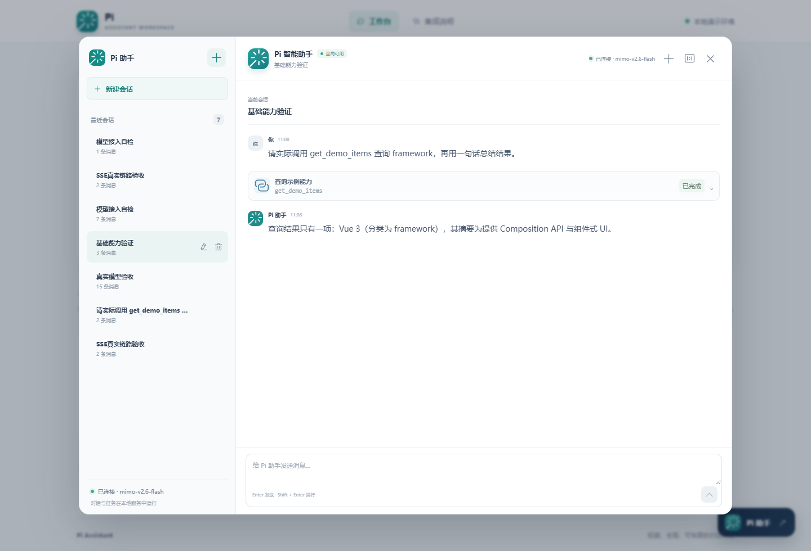
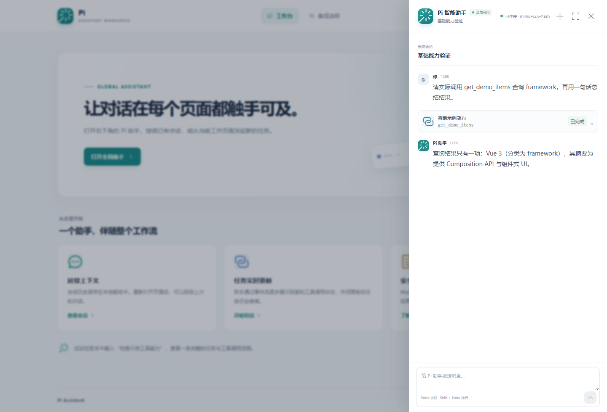
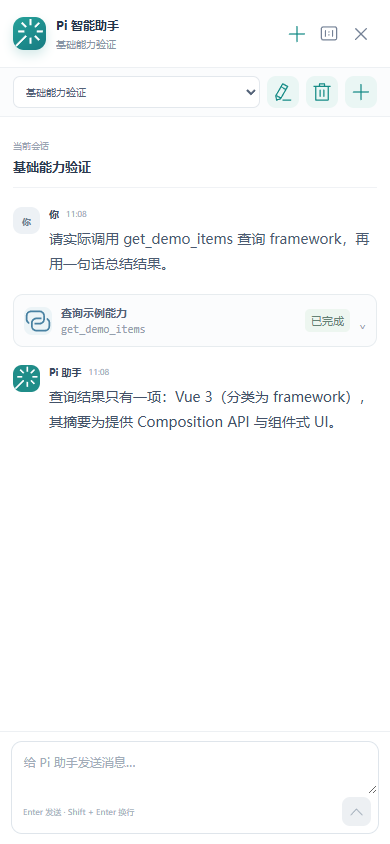

# Pi Vue3 Assistant

**用 Vue 3 为 Pi SDK 提供一个可复用的 Web 助手界面。**

A Vue 3 global assistant starter powered by Pi SDK and OpenAI-compatible models.

项目以源码工程的形式提供聊天界面、独立 Node.js 服务和共享协议，适合搭建自己的 Agent Web UI，或将全局助手嵌入已有 Vue3 应用。模型推理和工具循环由 Pi SDK 执行，前端通过 REST + SSE 接收状态。

## 功能

- 全局悬浮入口、对话侧栏、展开模式与移动端布局。
- Markdown、代码块和流式回复。
- 会话新建、切换、重命名、删除与本地持久化。
- 工具调用状态、参数及结果展示。
- 显式停止生成，断线重连、快照恢复与事件去重。
- 服务重启后保留历史，将未完成任务标记为中断。
- 可配置的 OpenAI Chat Completions 兼容模型。
- 受控 Skill 读取及示例工具，方便继续扩展。

## 截图

以下截图来自实际运行的界面，使用 MiMo 模型调用示例工具。

### 展开模式



<details>
<summary>查看侧栏模式和移动端</summary>

### 全局侧栏



### 移动端



</details>

## 快速开始

需要 **Node.js >= 22.19.0**、**pnpm 10.30.3**，以及支持流式响应和函数工具调用的 OpenAI Chat Completions 兼容端点。

```sh
git clone https://github.com/hyzhuzzz/pi-vue3.git
cd pi-vue3
pnpm install --frozen-lockfile
cp .env.example .env
```

PowerShell 中也可以使用 `Copy-Item .env.example .env`。编辑 `.env`，填写模型配置，再启动：

```sh
pnpm dev
```

打开 [开发页面](http://127.0.0.1:5173)。Node 服务默认在 `127.0.0.1:3001`，Vite 将助手 API 代理至该服务。

### 模型配置

```dotenv
OPENAI_BASE_URL=https://your-provider.example/v1
OPENAI_MODEL=your-model-id
OPENAI_API_KEY=your-api-key
```

`OPENAI_BASE_URL` 填 API 根地址，通常以 `/v1` 结尾。服务端 SDK 会追加 `/chat/completions`。

MiMo 示例：

```dotenv
OPENAI_BASE_URL=https://api.xiaomimimo.com/v1
OPENAI_MODEL=mimo-v2.6-flash
OPENAI_API_KEY=your-api-key
OPENAI_THINKING=disabled
```

本项目已使用 `mimo-v2.6-flash` 完成真实模型验证。其他兼容端点可以运行下文的 `test:live` 自检。

| 变量 | 用途 | 默认值 |
| --- | --- | --- |
| `OPENAI_BASE_URL` | 模型 API 根地址 | 需配置 |
| `OPENAI_MODEL` | 模型标识 | 需配置 |
| `OPENAI_API_KEY` | 服务端模型凭据 | 需配置 |
| `OPENAI_CONTEXT_WINDOW` | 模型上下文窗口元数据 | `262144` |
| `OPENAI_MAX_TOKENS` | 单次模型输出上限 | `4096` |
| `OPENAI_THINKING` | MiMo 思考模式适配 | 可选，设为 `disabled` |
| `DATA_DIR` | 相对仓库根目录或绝对数据路径 | `.data/assistant` |
| `PORT` | Node 服务端口 | `3001` |

密钥仅由服务端读取，`.env` 和数据目录均被 Git 忽略。前端不需要 `VITE_*` 密钥变量。修改服务端配置后重启服务。

## 构建与运行

```sh
pnpm build
pnpm --filter @pi-vue3/agent-server start
```

构建后的 Node 服务会同时提供前端静态文件和助手 API，打开 [本地服务](http://127.0.0.1:3001)。也可以将前端交给 Nginx 等静态服务器，单独转发助手 API。

当前版本面向单进程、可信单用户和本地文件存储，默认仅监听 loopback。多用户和网络部署需补充应用自身的身份认证、会话归属及权限控制。详见 [部署说明](docs/deployment.md)。

## 开发与测试

```sh
pnpm typecheck   # 类型检查
pnpm test        # 协议、服务端与前端单元测试
pnpm test:e2e    # 浏览器交互与窄屏测试
pnpm build      # 构建所有工作区包
```

浏览器测试使用可控接口，不需要真实模型。Windows 默认使用已安装的 Edge；其他系统先运行：

```sh
pnpm exec playwright install chromium
```

服务已启动且模型配置完成后，可执行真实模型自检：

```sh
pnpm test:live
```

它会实际调用配置的模型，验证文本、多轮上下文、Skill 读取及工具调用，并保留“模型接入自检”会话。此检查不参与默认测试或 CI。

## 工程结构

```text
apps/web/               Vue3 助手组件、状态管理与宿主演示
apps/agent-server/      HTTP/SSE、Pi 适配、会话与任务管理
packages/protocol/      前后端共享 DTO 和事件类型
skills/                 受控 Skill 目录及示例
tests/                  浏览器及真实模型自检
docs/                   架构、扩展、部署与截图
```

## 嵌入与扩展

`AssistantShell.vue` 负责全局入口和聊天窗口，通过 `baseUrl` 接入服务，通过 `pageContext` 接收宿主页面上下文：

```vue
<AssistantShell
  base-url="/api/assistant"
  :page-context="{ page: '文档中心' }"
/>
```

迁移时一并引入助手状态模块、共享协议和所需样式。组件使用示例见 [`App.vue`](apps/web/src/App.vue)。

- [架构与 API](docs/architecture.md)：会话、任务、流式事件及恢复方式。
- [工具与 Skill 扩展](docs/extensions.md)：工具注册、受控 Skill 读取和 MCP 接入位置。
- [贡献指南](CONTRIBUTING.md)：开发检查与提交约定。
- [验证记录](docs/verification.md)：自动测试、真实模型与运行检查。

示例工具返回演示数据。业务工具、MCP 客户端、模型管理、认证和用量治理可通过服务端边界继续扩展。

## 技术与参考

- [Pi SDK](https://pi.dev/docs/latest/sdk) — Agent 执行、会话和模型适配。
- [Vue3](https://vuejs.org/) / [Element Plus](https://element-plus.org/) — 界面与基础组件。
- [OpenAI Chat Completions](https://developers.openai.com/api/reference/resources/chat/subresources/completions/methods/create) — 模型接口协议。
- [MiMo 文档](https://mimo.mi.com/docs/zh-CN/quick-start/summary/first-api-call) — 实测模型接入说明。
- [Pi Web UI](https://github.com/xing-shuyin/pi-web-ui) — 聊天事件与会话交互参考。

## 许可证

[MIT](LICENSE) © 2026 Pi Vue3 Assistant contributors。
